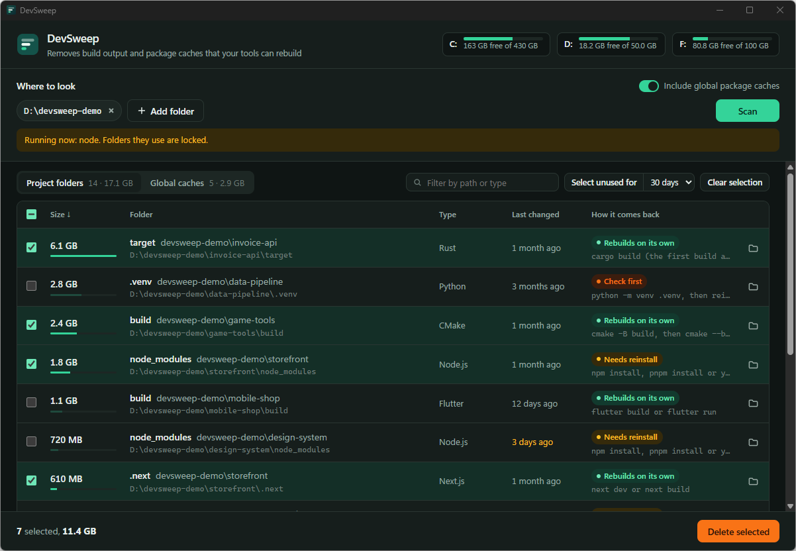

# DevSweep

DevSweep is a Windows desktop app that finds the files your development tools can rebuild and deletes the ones you pick. That means `node_modules`, Rust and Maven `target`, Gradle and CMake `build`, .NET `bin` and `obj`, Python virtual environments, and the package caches that npm, pnpm, Cargo, Gradle, NuGet, Go and pip keep in your user folder.



## The problem

Every project you clone, try or abandon leaves a copy of its dependencies and build output on disk. None of it is source code, and all of it comes back with one command, but it piles up quietly:

- A Rust project's `target` folder reaches 3 to 10 GB after a few debug and release builds. Each git worktree gets its own.
- Every JavaScript project carries its own `node_modules`, often 500 MB to 2 GB.
- Package managers keep a global cache of every version they ever downloaded. The npm cache, the pnpm store and `~/.cargo/registry` grow without limit.

On the machine DevSweep was written on, Rust `target` folders alone took 63 GB of a 100 GB drive.

You can delete these by hand, but you have to find them first, and you have to know which `build` or `target` folder is safe to delete. A folder called `build` might be Gradle output or might be your own build scripts. A `node_modules` folder inside `Program Files` belongs to an installed app, and deleting it breaks that app.

## What DevSweep does

1. **Scan.** Pick drives or folders. DevSweep walks them in parallel and lists every folder that a build tool or package manager owns, with its size, its age and the command that brings it back.
2. **Review.** Results are sorted by size. Folders unchanged for 30 days are selected for you; change that to 7, 90 days or anything. Folders a running program is using are locked.
3. **Delete.** DevSweep checks every folder again, deletes it, and reports how much free space you actually got back.

## Download

Grab the latest build from the [Releases page](https://github.com/tajbinkhan/devsweep/releases):

- `DevSweep_x.y.z_x64-setup.exe` installs DevSweep for the current user, with a Start menu entry and an uninstaller.
- `DevSweep-portable.zip` holds the exe on its own. Unzip and run it.

DevSweep needs Windows 10 or 11 with the WebView2 runtime, which Windows 11 ships with. The builds are not code-signed, so SmartScreen may show "Windows protected your PC" the first time. Click "More info", then "Run anyway".

## What it removes

**Project folders.** A folder only counts when the project file that owns it sits next to it. For ambiguous names like `build`, `target` and `bin`, DevSweep also needs a file that the build tool writes inside the folder.

| Folder | Needs next to it | Needs inside | Comes back with |
|---|---|---|---|
| `node_modules` | `package.json` | | `npm install` / `pnpm install` / `yarn` |
| `.next`, `.nuxt`, `.svelte-kit`, `.turbo`, `.parcel-cache` | `package.json` | | the next dev or build run |
| `.angular` | `angular.json` | `cache` | `ng build` |
| Rust `target` | `Cargo.toml` | `CACHEDIR.TAG`, `.rustc_info.json`, `debug` or `release` | `cargo build` |
| Maven `target` | `pom.xml` | `classes`, `maven-status`, ... | `mvn package` |
| Gradle `build`, `.gradle`, `.cxx` | `build.gradle(.kts)` or `settings.gradle(.kts)` | `build` needs `intermediates`, `classes`, `tmp`, ... | `gradle build` |
| .NET `bin`, `obj` | `*.csproj`, `*.fsproj`, `*.vbproj` | `Debug`, `Release` or `project.assets.json` | `dotnet build` |
| Flutter `.dart_tool`, `build` | `pubspec.yaml` | `build` needs Flutter output | `flutter pub get` / `flutter build` |
| CMake `build` | `CMakeLists.txt` | `CMakeCache.txt` | `cmake --build` |
| Python `.venv`, `venv` | `pyproject.toml`, `requirements.txt`, ... | `pyvenv.cfg` | recreate the venv (marked "Check first") |
| Python `.pytest_cache`, `.mypy_cache`, `.ruff_cache`, `.tox` | a Python project file | | the next run |
| PHP `vendor` | `composer.json` | `autoload.php` | `composer install` (marked "Check first") |
| Elixir `_build`, `deps`; Swift `.build`; Zig `.zig-cache`; Haskell `.stack-work` | the project file | | the usual build |

The full list is in [`src-tauri/src/rules.rs`](src-tauri/src/rules.rs).

**Global caches.** These live at fixed paths in your user folder: the npm, Yarn, Bun, pip and uv caches, the pnpm store, the Cargo registry and git checkouts, the Gradle, Maven and NuGet caches, the Go build and module caches, Electron, Playwright and Cypress downloads, and the TypeScript typings cache. DevSweep empties the cache folder and leaves the folder itself in place. For the pnpm store it runs `pnpm store prune`, which only removes packages no project uses.

## How it avoids breaking things

- **It only takes folders a project owns.** `node_modules` without a `package.json` next to it is ignored. So is a `target` folder next to `Cargo.toml` that holds notes instead of Cargo output.
- **It stays out of installed programs.** The scanner never enters Program Files, ProgramData, AppData, Windows, `.git`, editor folders (`.vscode`, `.cursor`, `.idea`), toolchain folders (`.rustup`, `.cargo`, `.nvm`), Steam and Epic libraries, or any `resources` folder. Installed Electron apps ship a `node_modules` next to a `package.json` inside `resources`, and those must never be offered.
- **It never follows links.** Symlinks and junctions are skipped during the scan and the delete. Deleting a junction inside `node_modules` removes the link and leaves the folder it points to alone.
- **It locks folders in use.** A folder can't be selected when a program runs from inside it, or when a dev tool (node, cargo, dotnet, java, python and others) has its working folder inside that project. Caches lock while their package manager runs.
- **It checks again before deleting.** The folder must be in the last scan, its project file must still be there, nothing may be using it, and the path must not be a drive root, your home folder, the Windows folder or a link.
- **It is cautious about environments.** Python virtual environments and PHP `vendor` folders are marked "Check first" and never selected automatically. Recreating them can take more than one command.
- **It runs as a normal user.** Some folders return "Access is denied", usually because a terminal running as administrator created them. The report then offers "Restart as administrator", which goes through the Windows UAC prompt and scans again. DevSweep never asks for elevation on its own, and the same rules and checks apply when elevated.
- **It reports what really changed.** pnpm and Cargo use hard links, so a folder's size can overstate what deleting it frees. The report shows the change in free disk space next to the counted size.

Files are deleted permanently. They don't go to the Recycle Bin, because moving 50 GB of `node_modules` to the Recycle Bin frees nothing.

## How it compares

| | DevSweep | [kondo](https://github.com/tbillington/kondo) | [npkill](https://github.com/voidcosmos/npkill) | WizTree, WinDirStat | Storage Sense, Disk Cleanup | `cargo clean`, `npm cache clean` and friends |
|---|---|---|---|---|---|---|
| Interface | Desktop GUI | CLI, plus a separate GUI | Terminal UI | Desktop GUI | Windows Settings | Command line |
| Finds build output across many projects | Yes, 29 folder types | Yes, about 20 project types | `node_modules` by default, other names on request | Shows everything, knows nothing | No | One project at a time |
| Checks the owning project file | Yes, plus a marker inside for ambiguous names | Yes | No, it matches folder names | No | n/a | n/a |
| Global package caches | Yes, 22 locations | No | No | Shows them | No | One tool each |
| Skips folders a running program uses | Yes | No | No | No | n/a | Some tools refuse while locked |
| Keeps out of installed apps | Fixed exclusion list | No | Flags them with a warning | No | n/a | n/a |
| Platforms | Windows | Windows, macOS, Linux | Anywhere Node.js runs | Windows | Windows | All |

The short version:

- **kondo** is the closest tool and works on every platform. It cleans project folders only and doesn't check whether a program is using them. Its own README calls it "essentially `rm -rf` with a prompt".
- **npkill** is the quickest way to clear `node_modules` folders from a terminal. Anything else you have to name yourself.
- **WizTree and WinDirStat** show where the space went. They can't tell you which of those folders is safe to delete.
- **Storage Sense and Disk Cleanup** clear Windows temp files, the Recycle Bin and update leftovers. They don't know developer folders exist.
- **Each tool's own clean command** is the most precise option. You need to remember about ten of them and run each one per project.

DevSweep is for the case where you want all of that in one pass, on Windows, and you'd rather click through a list than trust a glob.

## Limits

- Windows only. The scanner and rules would work elsewhere, but the in-use checks, link handling and installer are written for Windows.
- Deletion is permanent.
- The rule list covers common toolchains. If yours is missing, add a rule in `src-tauri/src/rules.rs`. Each rule is about ten lines.

## Build from source

You need Node.js 20 or later, Rust (stable), and the MSVC build tools. A MinGW toolchain with `windres` on `PATH` and the `x86_64-pc-windows-gnu` Rust target also works; the exe then needs `WebView2Loader.dll` next to it.

```bash
npm ci
npm run dev
```

Run the tests. They build fake projects in the temp folder and check what gets found and deleted, including junctions, read-only files and folders whose project file vanished after the scan:

```bash
cd src-tauri && cargo test
```

Build the installer and exe. The output lands in `src-tauri/target/release/bundle/nsis`:

```bash
npm run build
```

GitHub Actions runs the tests and builds both downloads on every push to `main`. Pushing a tag such as `v0.2.0` also publishes a release with the installer and the portable zip attached. See [`.github/workflows/build.yml`](.github/workflows/build.yml).

## Code layout

- `ui/` is the interface: plain HTML, CSS and JavaScript with no build step
- `src-tauri/src/rules.rs` decides which folders count, where the scanner never goes, and which global caches exist
- `src-tauri/src/scan.rs` walks folders in parallel and measures sizes
- `src-tauri/src/procs.rs` finds running programs that use a folder
- `src-tauri/src/clean.rs` deletes, and holds the last-chance path checks
- `src-tauri/src/main.rs` has the Tauri commands
- `src-tauri/src/tests.rs` has the tests against fake projects

## License

MIT. See [LICENSE](LICENSE).
