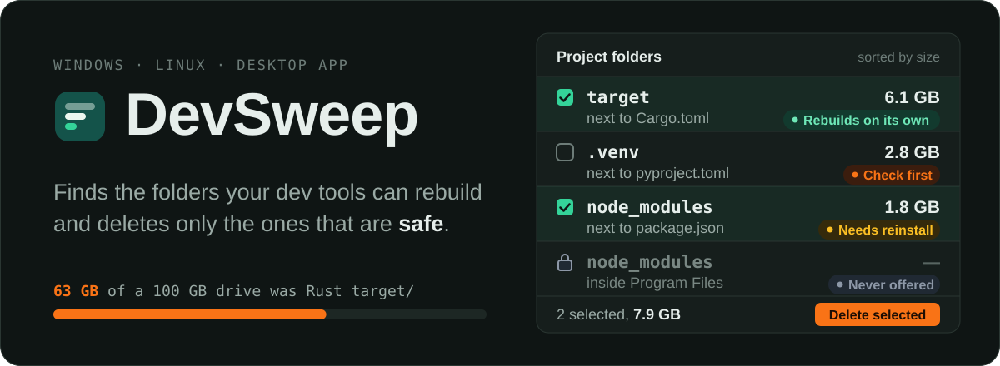
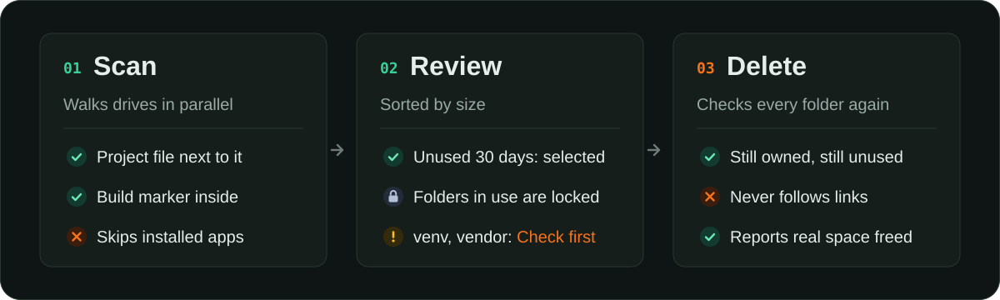

<h1 align="center">
  
</h1>

DevSweep is a desktop app for Windows, Linux and, as an experiment, macOS. It finds the files your development tools can rebuild and deletes the ones you pick: `node_modules`, Rust and Maven `target`, Gradle and CMake `build`, .NET `bin` and `obj`, Python virtual environments, and the package caches that npm, pnpm, Cargo, Gradle, NuGet, Go and pip keep in your user folder.

<p align="center">
  <a href="#installation"><b>Download DevSweep 0.4.0 for Windows, Linux or macOS</b></a>
  &nbsp;·&nbsp; <a href="#how-it-avoids-breaking-things">How it stays safe</a>
  &nbsp;·&nbsp; <a href="#how-it-compares">How it compares</a>
  &nbsp;·&nbsp; <a href="https://tajbinkhan.github.io/devsweep/">Website</a>
</p>


## Contents

- [Why DevSweep](#why-devsweep)
- [Features](#features)
- [Installation](#installation)
- [Usage](#usage)
- [Command line](#command-line)
- [What it removes](#what-it-removes)
- [How it avoids breaking things](#how-it-avoids-breaking-things)
- [How it compares](#how-it-compares)
- [Limits](#limits)
- [Development](#development)
- [Contributing](#contributing)
- [Signing and checksums](#signing-and-checksums)
- [Privacy](#privacy)
- [License](#license)

## Why DevSweep

Every project you clone, try or abandon leaves a copy of its dependencies and build output on disk. None of it is source code, and all of it comes back with one command, but it piles up quietly:

- A Rust project's `target` folder reaches 3 to 10 GB after a few debug and release builds. Each git worktree gets its own.
- Every JavaScript project carries its own `node_modules`, often 500 MB to 2 GB.
- Package managers keep a global cache of every version they ever downloaded. The npm cache, the pnpm store and `~/.cargo/registry` grow without limit.

On the machine DevSweep was written on, Rust `target` folders alone took 63 GB of a 100 GB drive.

Deleting these by hand means finding them first and knowing which ones are safe. A folder called `build` might be Gradle output or your own build scripts. A `node_modules` inside `Program Files` belongs to an installed app, and deleting it breaks that app. DevSweep makes that call for you, and shows its reasoning.

## Features

- **Finds build output across every project at once.** 42 folder types from Node.js, Rust, Java, .NET, Flutter, CMake, Python, PHP, Elixir, Swift, Zig, Haskell, Terraform, Unity and Unreal.
- **Only offers folders a project owns.** Each match needs its project file next to it, and ambiguous names like `build` or `target` also need a file the build tool writes inside.
- **Cleans global package caches.** npm, Yarn, Bun, pnpm, Deno, Cargo, pip, uv, Poetry, Composer, Gradle, Maven, NuGet, Go, Electron, Playwright, Cypress and more, plus downloaded AI models from Hugging Face, Ollama, LM Studio and PyTorch hub.
- **Cleans up after Docker.** The build cache, images no container uses, stopped containers and unused volumes, measured and removed by Docker itself.
- **Shrinks WSL disks on Windows.** A WSL distribution's `ext4.vhdx`, and Docker Desktop's data disk, grow as Linux writes files and never shrink on their own. DevSweep estimates the empty part and compacts the file to give it back to the drive.
- **Knows which projects you still use.** "Unused for 30 days" goes by when you last worked on the project, not when its `node_modules` was installed.
- **Locks folders in use.** Anything a running program or dev tool is using can't be selected, and a cache can't be cleaned while its package manager is installing.
- **Keeps what you tell it to.** Mark a project as kept and it is never offered again.
- **Stays out of installed programs** and system folders through a fixed exclusion list.
- **Shows real savings before you delete.** On Linux, sizes count a hard-linked file once and leave out files shared with the pnpm store, so a pnpm `node_modules` shows what deleting it actually frees. After deleting, the report shows the change in free disk space.
- **Exports the list** as CSV or JSON, and has a [command line](#command-line) for scripts and scheduled cleanups.
- **Updates itself.** The Windows installer and the AppImage download, verify and install a new release with one click. See [Updates](#updates).
- **Runs as a normal user** and never elevates on its own.

## Installation

The current version is **0.4.0** ([release notes](https://github.com/tajbinkhan/devsweep/releases/tag/v0.4.0)). Older versions are on the [Releases page](https://github.com/tajbinkhan/devsweep/releases).

| System | Download | Size |
|---|---|---|
| Windows, installer | [DevSweep_0.4.0_x64-setup.exe](https://github.com/tajbinkhan/devsweep/releases/download/v0.4.0/DevSweep_0.4.0_x64-setup.exe) | 3.3 MB |
| Windows, portable | [DevSweep_0.4.0_x64-portable.zip](https://github.com/tajbinkhan/devsweep/releases/download/v0.4.0/DevSweep_0.4.0_x64-portable.zip) | 4.5 MB |
| Debian, Ubuntu, Mint, Pop!_OS | [DevSweep_0.4.0_amd64.deb](https://github.com/tajbinkhan/devsweep/releases/download/v0.4.0/DevSweep_0.4.0_amd64.deb) | 4.7 MB |
| Fedora, RHEL, openSUSE | [DevSweep-0.4.0-1.x86_64.rpm](https://github.com/tajbinkhan/devsweep/releases/download/v0.4.0/DevSweep-0.4.0-1.x86_64.rpm) | 4.7 MB |
| Any Linux | [DevSweep_0.4.0_amd64.AppImage](https://github.com/tajbinkhan/devsweep/releases/download/v0.4.0/DevSweep_0.4.0_amd64.AppImage) | 83 MB |
| macOS 11 or later, experimental | [DevSweep_0.4.0_universal.dmg](https://github.com/tajbinkhan/devsweep/releases/download/v0.4.0/DevSweep_0.4.0_universal.dmg) | 7.5 MB |
| Checksums for all of the above | [SHA256SUMS.txt](https://github.com/tajbinkhan/devsweep/releases/download/v0.4.0/SHA256SUMS.txt) | |

The installer and the AppImage update themselves from here on. The portable zip, `.deb` and `.rpm` tell you when a new version is out. See [Updates](#updates).

### Windows

- `DevSweep_0.4.0_x64-setup.exe` installs DevSweep for the current user, with a Start menu entry and an uninstaller.
- `DevSweep_0.4.0_x64-portable.zip` holds the exe on its own. Unzip and run it.

DevSweep needs Windows 10 or 11 with the WebView2 runtime, which Windows 11 ships with.

The Windows downloads are not code-signed, so SmartScreen shows "Windows protected your PC" the first time you run one. Click **More info**, then **Run anyway**. To check a download before you run it, see [Signing and checksums](#signing-and-checksums). With the installer you only see this once, because later versions arrive through the built-in updater.

### Linux

Debian, Ubuntu, Mint and Pop!_OS:

```bash
wget https://github.com/tajbinkhan/devsweep/releases/download/v0.4.0/DevSweep_0.4.0_amd64.deb
sudo apt install ./DevSweep_0.4.0_amd64.deb
```

Fedora, RHEL and openSUSE:

```bash
sudo dnf install https://github.com/tajbinkhan/devsweep/releases/download/v0.4.0/DevSweep-0.4.0-1.x86_64.rpm
```

Any distribution, without installing:

```bash
wget https://github.com/tajbinkhan/devsweep/releases/download/v0.4.0/DevSweep_0.4.0_amd64.AppImage
chmod +x DevSweep_0.4.0_amd64.AppImage
./DevSweep_0.4.0_amd64.AppImage
```

The Linux builds need WebKitGTK 4.1, which the `.deb` and `.rpm` pull in on their own. They are built on Ubuntu 22.04, so they run on distributions from 2022 onward.

### macOS (experimental)

The macOS build is experimental. GitHub's macOS runners build and test it, but nobody has tried it on a real Mac yet. If you do, [say how it went](https://github.com/tajbinkhan/devsweep/issues).

Releases from 0.4.0 on include `DevSweep_<version>_universal.dmg`, one app for Apple Silicon and Intel Macs on macOS 11 or later. Open the disk image and drag DevSweep to Applications.

The app has no Apple Developer ID signature and is not notarized, so macOS blocks it the first time. Open **System Settings**, then **Privacy & Security**, scroll to the message about DevSweep and click **Open Anyway**. If macOS says the app is damaged instead, remove the download quarantine in Terminal:

```bash
xattr -dr com.apple.quarantine /Applications/DevSweep.app
```

macOS asks before any app reads Desktop, Documents, Downloads and a few other folders. Allow it, or DevSweep reports those folders as access denied. To scan without the prompts, add DevSweep under **Privacy & Security**, **Full Disk Access**.

### Updates

When DevSweep starts, and once a day while it stays open, it downloads `latest.json` from the newest GitHub release. If that names a newer version, a bar at the top of the window says so. A check that fails, for example while offline, is tried again within the hour.

| Installed from | What the bar offers |
|---|---|
| Windows installer (`-setup.exe`) | **Update and restart**: the new installer runs without questions and starts DevSweep again |
| AppImage | **Update and restart**: the AppImage file is replaced and DevSweep starts again |
| Portable zip, `.deb`, `.rpm` | **Download**: opens the releases page. apt and dnf need root to update a package, and the portable exe has no installer |
| macOS app | **Download**: opens the releases page. The app is not notarized, so it does not replace itself |

**Skip this version** hides the bar for that release for good; it comes back when a newer one is out. Closing the bar with the cross hides it until DevSweep starts again. **Check now** shows any newer release, skipped or not.

Every update is signed in the release workflow, and DevSweep checks the signature, and the version inside it, against the public key built into the app before installing anything. A download that was changed, or an old release passed off as a new one, is refused. Nothing installs without a click, and DevSweep refuses to update during a scan or a delete.

The check is the only network request DevSweep makes. GitHub sees your IP address and DevSweep sends nothing else. To turn it off, click the version number next to the DevSweep name and clear **Check for updates when DevSweep starts and once a day**. **Check now** in the same dialog checks once.

## Usage

<p align="center">
  
</p>

1. **Scan.** Pick drives or folders. DevSweep walks them in parallel and lists every folder that a build tool or package manager owns, with its size, its age and the command that brings it back.
2. **Review.** Results are sorted by size. Folders unused for 30 days are selected for you; change that to 7, 90 days or anything else. "Last used" is the later of when the folder was last written and when its project was last changed (its files a few levels down, and git's index), so a project you edit every day keeps its `node_modules` even if you installed it months ago. Folders a running program is using are locked, Python virtual environments and PHP `vendor` folders are marked "Check first" and never selected automatically, and the bookmark button on a row keeps that project out for good. Shift-click selects a range.
3. **Delete.** DevSweep checks every folder again, deletes it, and reports how much free space you actually got back.

The last scan is saved and shown again the next time you open DevSweep, so you can come back to a list without scanning again. Everything is still checked again before it is deleted.

Files are deleted permanently. They don't go to the Recycle Bin or the Trash, because moving 50 GB of `node_modules` there frees nothing.

**If a folder reports "Access is denied":**

- On Windows, a terminal running as administrator usually created it. The report offers **Restart as administrator**, which goes through the UAC prompt and scans again with the same rules and checks.
- On Linux, the folder usually holds root-owned files from `sudo npm install` or a Docker build. The report shows the `chown` command that gives it back to you, for example:

  ```bash
  sudo chown -R "$USER": ~/projects/my-app/node_modules
  ```

## Command line

The same rules, checks and keep list are available without the window:

```bash
devsweep scan ~/code
```

```bash
devsweep clean ~/code --older-than 60 --caches --dry-run
```

`scan` lists what DevSweep found, with a `*` next to what `clean` would delete. `clean` deletes folders unused for `--older-than` days (30 by default) and asks first; add `--yes` to skip the question in a script or a cron job. `--json` prints the result as JSON, `--include-caution` also takes folders marked "Check first", `--caches` adds the global caches, Docker and WSL disks, and with no folder it scans your home folder and every drive except the system one. `devsweep --help` lists everything. On Linux the `.deb` and `.rpm` put `devsweep` on your `PATH`.

## What it removes

**Project folders.** A folder only counts when the project file that owns it sits next to it. For ambiguous names like `build`, `target` and `bin`, DevSweep also needs a file that the build tool writes inside the folder.

| Folder | Needs next to it | Needs inside | Comes back with |
|---|---|---|---|
| `node_modules` | `package.json` | | `npm install` / `pnpm install` / `yarn` |
| `.next`, `.nuxt`, `.svelte-kit`, `.turbo`, `.parcel-cache` | `package.json` | | the next dev or build run |
| `.angular` | `angular.json` | `cache` | `ng build` |
| Rust `target` | `Cargo.toml` | `CACHEDIR.TAG`, `.rustc_info.json`, `debug` or `release` | `cargo build` |
| Maven `target` | `pom.xml` | `classes`, `maven-status`, ... | `mvn package` |
| Gradle `build`, `.gradle`, `.cxx` | `build.gradle(.kts)` or `settings.gradle(.kts)` | `build` needs `intermediates`, `classes`, `tmp`, ... | `gradle build` |
| .NET `bin`, `obj` | `*.csproj`, `*.fsproj`, `*.vbproj` | `Debug`, `Release` or `project.assets.json` | `dotnet build` |
| Flutter `.dart_tool`, `build` | `pubspec.yaml` | `build` needs Flutter output | `flutter pub get` / `flutter build` |
| CMake `build` | `CMakeLists.txt` | `CMakeCache.txt` | `cmake --build` |
| Python `.venv`, `venv` | `pyproject.toml`, `requirements.txt`, ... | `pyvenv.cfg` | recreate the venv (marked "Check first") |
| Python `.pytest_cache`, `.mypy_cache`, `.ruff_cache`, `.tox` | a Python project file | | the next run |
| PHP `vendor` | `composer.json` | `autoload.php` | `composer install` (marked "Check first") |
| Python `__pycache__` | a `.py` file | a `.pyc` file | the next import |
| `.output` (Nuxt 3), `.docusaurus`, `.expo` | the framework's config file | | the next dev or build run |
| JavaScript `coverage` | `package.json` | `lcov.info`, `coverage-final.json`, ... | the next test run with coverage |
| Terraform `.terraform` | a `*.tf` file | `providers` or `modules` | `terraform init` |
| Unity `Library` | `ProjectSettings/ProjectVersion.txt` | `ArtifactDB`, `PackageCache`, ... | opening the project in Unity |
| Unreal `Intermediate`, `DerivedDataCache`, `Binaries` | a `*.uproject` file | `Intermediate` and `Binaries` need build output | building or opening the project |
| Elixir `_build`, `deps`; Swift `.build`; Zig `.zig-cache`, `zig-out`; Haskell `.stack-work`; Elm `elm-stuff`; Clojure `.cpcache` | the project file | | the usual build |

The full list is in [`src-tauri/src/rules.rs`](src-tauri/src/rules.rs).

**Global caches.** These live at fixed paths in your user folder (`%LOCALAPPDATA%` on Windows; `~/.cache`, `~/.local/share` and dot folders such as `~/.npm` and `~/.cargo` on Linux): the npm, Yarn, Bun, Deno, pip, uv, Poetry and Composer caches, the pnpm store, the Cargo registry and git checkouts, sccache and ccache, the Gradle, Maven and NuGet caches, the Go build and module caches, pre-commit environments, Electron, Playwright, Cypress and Puppeteer downloads, and the TypeScript typings cache. DevSweep empties the cache folder and leaves the folder itself in place. For the pnpm store it runs `pnpm store prune`, which only removes packages no project uses.

**AI models.** These sit in the same Global caches list, under "Machine learning". Each row removes every model in that folder:

| Row | Folder | Moved by | Marked | Locked while |
|---|---|---|---|---|
| Hugging Face models | `~/.cache/huggingface/hub` | `HF_HUB_CACHE`, `HF_HOME` | Needs reinstall | |
| Ollama models | `~/.ollama/models` | `OLLAMA_MODELS` | Needs reinstall: `ollama pull` | Ollama runs |
| LM Studio models | `~/.lmstudio/models`, or `~/.cache/lm-studio/models` before 0.3 | | Check first: imported models have no other copy | LM Studio or `lms` runs |
| PyTorch hub models | `~/.cache/torch/hub` | `TORCH_HOME`, `XDG_CACHE_HOME` | Needs reinstall | |

`~` is your user folder on Windows too. A variable that is empty or holds a relative path is ignored. A models folder you moved in LM Studio's own settings is not found.

**Docker.** When Docker is running, DevSweep asks it with `docker system df` what it can free, and lists each kind under Global caches with the command that cleans it:

| Row | Cleaned with | Marked |
|---|---|---|
| Docker build cache | `docker builder prune --all` | Rebuilds on its own |
| Unused Docker images | `docker image prune --all` | Needs reinstall: pulled again over the network |
| Stopped Docker containers | `docker container prune` | Check first: the files a container wrote are lost |
| Unused Docker volumes | `docker volume prune --all` | Check first: volumes often hold databases |

Docker removes only what no container uses, and the build cache locks while a `docker build` runs. Docker does not record when an image was last used, so these rows show "Not tracked" and "Select unused" never ticks them; on the command line only `--older-than 0` picks them. With Docker Desktop, or any Docker that runs inside WSL, the space is freed inside a virtual disk file, and the report says so: compact that disk next to give it back to the drive.

**WSL disks (Windows).** Each WSL 2 distribution keeps its files in an `ext4.vhdx` that grows and never shrinks, and Docker Desktop keeps its images in `docker_data.vhdx`. DevSweep finds the registered distributions and Docker Desktop's disk, and estimates what compacting gives back: the file size minus what `df` reports in use inside a running distribution, or what Docker Desktop reports it stores. A disk that cannot be looked into keeps the estimate from the last scan that could, or shows the whole file size until then. Compacting:

- is marked "Check first", because it runs `wsl --shutdown` first, which stops every running distribution and the containers in it,
- is locked while Docker Desktop runs, since Docker starts WSL again straight away,
- needs administrator rights (it uses `diskpart`), and DevSweep checks for them before stopping WSL; the report offers **Restart as administrator** otherwise,
- deletes nothing inside the disk.

## How it avoids breaking things

- **It only takes folders a project owns.** `node_modules` without a `package.json` next to it is ignored. So is a `target` folder next to `Cargo.toml` that holds notes instead of Cargo output.
- **It stays out of installed programs.** The scanner never enters Program Files, ProgramData, AppData, Windows, `.git`, editor folders (`.vscode`, `.cursor`, `.idea`), toolchain folders (`.rustup`, `.cargo`, `.nvm`), Steam and Epic libraries, or any `resources` folder. Installed Electron apps ship a `node_modules` next to a `package.json` inside `resources`, and those must never be offered. On Linux it also skips `/usr`, `/opt`, `/var`, `/etc` and the other system folders, `~/.config`, `~/.cache`, `~/.local`, Flatpak (`~/.var`) and Snap (`~/snap`) apps, Wine prefixes, and Node version managers and global npm prefixes (`.volta`, `.fnm`, `.asdf`, `.npm-global`), where globally installed tools look just like projects.
- **It never follows links.** Symlinks and junctions are skipped during the scan and the delete. Deleting a junction inside `node_modules` removes the link and leaves the folder it points to alone.
- **It locks folders in use.** A folder can't be selected when a program runs from inside it, or when a dev tool (node, cargo, dotnet, java, python and others) has its working folder inside that project. Caches lock while their package manager installs. DevSweep reads command lines to see npm, pnpm and yarn running inside `node`, Composer inside `php` and Gradle or Maven inside `java`. A dev server started with `pnpm dev` or `npm run` does not lock the caches, because it never touches them.
- **It never leaves a project half-deleted.** A folder is renamed (to `node_modules.<time>.devsweep-trash`) before anything inside it is deleted, so if deleting stops part way the project simply has no `node_modules`, not a broken one. The next scan offers what was left. Running programs are looked at again every few seconds during a long delete.
- **It checks again before deleting.** The folder must be in the last scan, its project file must still be there, nothing may be using it, and the path must not be a drive root, your home folder, the Windows folder, a Linux system folder such as `/usr` or `/opt`, or a link.
- **It is cautious about environments.** Python virtual environments and PHP `vendor` folders are marked "Check first" and never selected automatically. Recreating them can take more than one command.
- **It respects the keep list.** Kept folders are marked in every scan and refused at delete time, from the window and the command line alike.
- **It runs as a normal user.** Some folders return "Access is denied", usually because a terminal running as administrator created them. On Windows the report then offers "Restart as administrator", which goes through the UAC prompt and scans again. DevSweep never asks for elevation on its own, and the same rules and checks apply when elevated. On Linux such folders usually hold files owned by root, from `sudo npm install` or a Docker build. DevSweep does not run itself as root; the report shows the `chown` command that gives the folder back to you.
- **It reports what really changed.** pnpm and Cargo use hard links, so a folder's size can overstate what deleting it frees. The report shows the change in free disk space next to the counted size.

## How it compares

| | DevSweep | [kondo](https://github.com/tbillington/kondo) | [npkill](https://github.com/voidcosmos/npkill) | WizTree, WinDirStat | Storage Sense, Disk Cleanup | `cargo clean`, `npm cache clean` and friends |
|---|---|---|---|---|---|---|
| Interface | Desktop GUI | CLI, plus a separate GUI | Terminal UI | Desktop GUI | Windows Settings | Command line |
| Finds build output across many projects | Yes, 42 folder types | Yes, about 20 project types | `node_modules` by default, other names on request | Shows everything, knows nothing | No | One project at a time |
| Checks the owning project file | Yes, plus a marker inside for ambiguous names | Yes | No, it matches folder names | No | n/a | n/a |
| Global package caches | Yes, over 30 locations | No | No | Shows them | No | One tool each |
| Docker and WSL disks | Prunes Docker, compacts WSL disks | No | No | Shows the disk files | No | `docker system prune`, `diskpart` by hand |
| Skips folders a running program uses | Yes | No | No | No | n/a | Some tools refuse while locked |
| Keeps out of installed apps | Fixed exclusion list | No | Flags them with a warning | No | n/a | n/a |
| Platforms | Windows, Linux, macOS (experimental) | Windows, macOS, Linux | Anywhere Node.js runs | Windows | Windows | All |

The short version:

- **kondo** is the closest tool and works on every platform. It cleans project folders only and doesn't check whether a program is using them. Its own README calls it "essentially `rm -rf` with a prompt".
- **npkill** is the quickest way to clear `node_modules` folders from a terminal. Anything else you have to name yourself.
- **WizTree and WinDirStat** show where the space went. They can't tell you which of those folders is safe to delete.
- **Storage Sense and Disk Cleanup** clear Windows temp files, the Recycle Bin and update leftovers. They don't know developer folders exist.
- **Each tool's own clean command** is the most precise option. You need to remember about ten of them and run each one per project.

DevSweep is for the case where you want all of that in one pass, on Windows or Linux, and you'd rather click through a list than trust a glob.

## Limits

- Docker builds run inside WSL or a container are not seen, so they do not lock the Docker build cache. Docker itself still refuses to remove anything a container uses.
- Compacting a WSL disk needs administrator rights and stops WSL. DevSweep has no way to compact a disk while a distribution runs.

- Windows and Linux are tested on real machines. The macOS build has only run on GitHub's macOS runners. On macOS, folders that the privacy settings block show up as access denied, with advice about `chown` that does not apply.
- On Linux the in-use check sees only your own processes. A dev server run by another user or inside a container does not lock a folder.
- On Linux DevSweep cannot restart itself as root. Folders full of root-owned files have to be handed back with `chown` first.
- Deletion is permanent.
- On Windows, sizes count hard-linked files once per link, since Windows does not report links cheaply. The free-space change in the report is accurate.
- On Windows the command line runs from the GUI executable, so `cmd` returns to its prompt before the output finishes. Pipe it (`devsweep scan | more`) to wait. This path is not yet tested on Windows.
- The rule list covers common toolchains. If yours is missing, add a rule in `src-tauri/src/rules.rs`. Each rule is about ten lines.

## Development

DevSweep is a [Tauri 2](https://tauri.app) app: a Rust backend in `src-tauri/` and a plain HTML, CSS and JavaScript interface in `ui/` with no build step.

### Prerequisites

- Node.js 20 or later
- Rust (stable)
- **Windows:** the MSVC build tools. A MinGW toolchain with `windres` on `PATH` and the `x86_64-pc-windows-gnu` Rust target also works; the exe then needs `WebView2Loader.dll` next to it.
- **Linux:** the WebKitGTK and GTK development packages.

  Debian and Ubuntu:

  ```bash
  sudo apt install libwebkit2gtk-4.1-dev build-essential libxdo-dev libssl-dev libayatana-appindicator3-dev librsvg2-dev
  ```

  Fedora:

  ```bash
  sudo dnf install webkit2gtk4.1-devel openssl-devel libxdo-devel libappindicator-gtk3-devel librsvg2-devel
  ```
- **macOS:** the Xcode Command Line Tools (`xcode-select --install`).

### Run from source

```bash
git clone https://github.com/tajbinkhan/devsweep.git
cd devsweep
npm ci
npm run dev
```

### Test

The tests build fake projects in the temp folder and check what gets found and deleted, including junctions and symlinks, read-only files and folders, and folders whose project file vanished after the scan:

```bash
cd src-tauri && cargo test
```

The interface's selection and formatting rules live in `ui/logic.js` and have their own tests:

```bash
node --test "tests/ui/*.test.js"
```

GitHub Actions runs both, plus `cargo clippy -- -D warnings`, on Windows, Linux and macOS for every push to `main` and every pull request ([`ci.yml`](.github/workflows/ci.yml)). A macOS failure shows up in the run without failing it, since macOS support is experimental.

### Build packages

```bash
npm run build
```

On Windows the installer lands in `src-tauri/target/release/bundle/nsis`. On Linux the `.deb`, `.rpm` and AppImage land in `src-tauri/target/release/bundle/deb`, `rpm` and `appimage`. On macOS the app and the disk image land in `src-tauri/target/release/bundle/macos` and `dmg`. The release workflow builds one universal app for both Mac architectures with `npm run build -- --target universal-apple-darwin`, which needs `rustup target add aarch64-apple-darwin x86_64-apple-darwin` first.

### Code layout

- `ui/` is the interface: plain HTML, CSS and JavaScript with no build step
- `src-tauri/src/rules.rs` decides which folders count, where the scanner never goes, and which global caches exist
- `src-tauri/src/scan.rs` walks folders in parallel and measures sizes
- `src-tauri/src/procs.rs` finds running programs that use a folder
- `src-tauri/src/clean.rs` deletes, and holds the last-chance path checks
- `src-tauri/src/main.rs` has the Tauri commands
- `src-tauri/src/cli.rs` is the command line
- `src-tauri/src/docker.rs` reads `docker system df` and runs the prunes
- `src-tauri/src/wsl.rs` finds WSL disk files, estimates their empty space and compacts them
- `src-tauri/src/command.rs` runs docker, wsl and diskpart with a time limit
- `src-tauri/src/updates.rs` checks GitHub for a new release and installs it
- `.github/scripts/updater-manifest.mjs` writes `latest.json` for a release
- `site/` is the website at [tajbinkhan.github.io/devsweep](https://tajbinkhan.github.io/devsweep/), published by [`pages.yml`](.github/workflows/pages.yml) when it changes on `main`. Change its download links with each release, as with this README.
- `.github/scripts/mark-nsis-exe.mjs` marks the installer's copy of the exe before it is code-signed, and `.github/signpath` holds the SignPath artifact configurations
- `src-tauri/src/store.rs` saves the keep list, the last scan, WSL disk estimates and settings, and writes exports
- `src-tauri/src/tests.rs` has the tests against fake projects
- `tests/ui` has the tests for `ui/logic.js`

### Publishing a release

Downloads are built only when a GitHub Release is published ([`release.yml`](.github/workflows/release.yml)).

Once, before the first release with updates: add the updater's private key as the repository secret `TAURI_SIGNING_PRIVATE_KEY` (**Settings**, **Secrets and variables**, **Actions**). If the key has a password, add it as `TAURI_SIGNING_PRIVATE_KEY_PASSWORD`. The matching public key is `plugins.updater.pubkey` in [`tauri.conf.json`](src-tauri/tauri.conf.json). Keep a backup of the private key: without it, installed copies can never be updated again, and a new key pair only reaches people who download the next version by hand.

Windows code signing through SignPath is built into the workflow but switched off. The free [SignPath Foundation](https://signpath.org) program looks for more public use than the project had in November 2026, so apply again once it has grown, or use a paid SignPath plan. To switch it on:

1. In SignPath, create two artifact configurations with the slugs `exe` and `installer`, and paste in [`.github/signpath/exe.xml`](.github/signpath/exe.xml) and [`.github/signpath/installer.xml`](.github/signpath/installer.xml). They sign only files named DevSweep that carry the version being released. When those files change in the repository, paste them into SignPath again.
2. Add a SignPath API token for a user with the submitter role as the repository secret `SIGNPATH_API_TOKEN`.
3. Add the SignPath organization ID as the repository variable `SIGNPATH_ORGANIZATION_ID` (**Settings**, **Secrets and variables**, **Actions**, **Variables**). If the project or signing policy slug is not `devsweep` or `release-signing`, set `SIGNPATH_PROJECT_SLUG` or `SIGNPATH_SIGNING_POLICY_SLUG` as well.

Until `SIGNPATH_ORGANIZATION_ID` is set, releases publish unsigned Windows files. Once it is set, each release sends two signing requests, the exe and then the installer built around it, and someone with the approver role has to approve each one in SignPath within an hour.

For each release:

1. On GitHub, open **Releases**, then **Draft a new release**.
2. Create a tag such as `v0.2.0`. It must be `v` followed by three numbers.
3. Write the notes, or click **Generate release notes**, then **Publish release**.
4. Once the downloads are attached, change the version in the [Installation](#installation) section and the download link at the top of this README, and the version, links and sizes in `site/index.html`. Check the file sizes against the release. The first release with a macOS disk image also needs a macOS row in both download tables.

The workflow builds the Windows installer, the portable zip, the `.deb`, the `.rpm`, the AppImage and the macOS disk image, and attaches them to that release after a few minutes. If the experimental macOS build fails, the release goes out without it and `latest.json` leaves macOS out. The version inside the app and in the file names comes from the tag, so `tauri.conf.json` does not need editing. When SignPath is set up, a job code-signs the Windows exe and installer before anything is published. A separate job then signs the installer and the AppImage for the updater, and `latest.json` is uploaded last, so installed copies only hear about a release once its downloads are in place. The publish job also writes `SHA256SUMS.txt` from the exact files it attaches. Mark a release as a pre-release to keep it from installed copies: they follow GitHub's "latest" release. Running the Release workflow by hand from the Actions tab builds the same files as workflow artifacts without publishing anything.

## Contributing

Bug reports and pull requests are welcome on [GitHub](https://github.com/tajbinkhan/devsweep/issues).

- **Missing toolchain?** Add a `ProjectRule` to `PROJECT_RULES` in [`src-tauri/src/rules.rs`](src-tauri/src/rules.rs) (about ten lines), or a line to `cache_entries` for a global cache. Add a case to [`src-tauri/src/tests.rs`](src-tauri/src/tests.rs) that builds a fake project and checks the folder is found, and that a lookalike folder without the project file is not.
- **Something deleted that shouldn't have been, or offered that looked unsafe?** Open an issue with the folder path, what was next to it and what was inside. These are the most valuable reports.
- Run `cargo test` and `cargo clippy --all-targets` in `src-tauri`, and `node --test "tests/ui/*.test.js"`, before opening a pull request. CI runs the same checks on Windows, Linux and macOS.

## Signing and checksums

Every download is built by the release workflow ([`release.yml`](.github/workflows/release.yml)) on GitHub-hosted runners, from the source at the release tag. Nothing built anywhere else is attached to a release.

- **Windows code signing:** none yet. The release workflow can already sign through SignPath, so Windows signing starts once the project has a certificate.
- **Updates:** signed. The installer and the AppImage that the updater installs carry a signature that DevSweep checks against the public key built into the app. See [Updates](#updates).
- **Checksums:** each release from 0.4.0 on has a `SHA256SUMS.txt` with the SHA-256 hash of every download.

To check a Windows download, run this in PowerShell in the folder that holds it, and compare the result with the line for that file in `SHA256SUMS.txt`:

```powershell
Get-FileHash .\DevSweep_*_x64-setup.exe
```

On Linux, put `SHA256SUMS.txt` next to the downloads and run:

```sh
sha256sum --check --ignore-missing SHA256SUMS.txt
```

## Privacy

DevSweep sends nothing about you or your files anywhere. Its only network request is the update check described in [Updates](#updates), which fetches `latest.json` from GitHub Releases when DevSweep starts and once a day, and which you can turn off. Installing an update downloads it from the same place. GitHub's [privacy statement](https://docs.github.com/site-policy/privacy-policies/github-general-privacy-statement) covers those requests.

## License

MIT. See [LICENSE](LICENSE).
